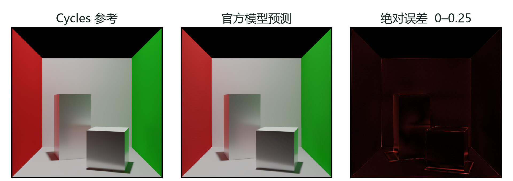
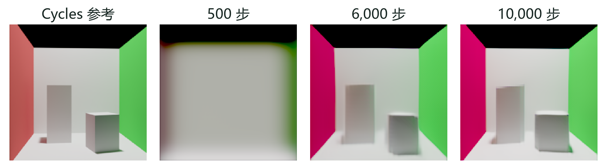

# Transformer学习方法及其在三角网格神经渲染中的应用——以RenderFormer为例

## 一 Transformer学习方法

渲染根据几何、材质、光源和相机生成图像。路径追踪通过采样光的传播路径求解这一问题，神经渲染则从场景与参考图的配对数据中学习预测。RenderFormer把三角网格转化为token序列，用Transformer建立场景关系，再生成指定相机下的HDR图像。[1,2] 本文介绍这一学习过程，并以官方模型推理和Cornell场景族训练进行验证。

Transformer的基本计算单元是注意力。设矩阵X的每一行是一个token，经三个可学习投影得到查询Q、键K和值V：

$$ Q = XW_Q，K = XW_K，V = XW_V $$

$$ Attention(Q,K,V) = softmax(QKᵀ / √dₖ)V $$

QKᵀ的第i行第j列表示查询i与键j的匹配程度；除以键向量维数的平方根可控制数值尺度。softmax沿键的方向归一化，再对V加权求和，得到更新后的特征。例如，一个三角形的查询可以聚合其他三角形的几何、材质与光照相关信息；参与聚合的权重由训练学得，不需要人为指定邻接关系。

自注意力的Q、K、V来自同一序列，负责序列内部的信息交换。交叉注意力允许查询与键值来自不同序列，例如由相机射线束提出查询、从场景特征中读取信息。多头注意力并行采用多组投影，再拼接各头结果，使模型在不同特征空间中建立关系。它提供了多种信息组合方式，但某个头并不天然对应阴影、反射或一次物理反弹。

注意力输出还要经过前馈网络、残差连接和归一化。前馈网络逐token进行非线性变换；残差保留原特征，为深层网络提供较直接的梯度路径；归一化则控制特征尺度。以预归一化结构作示意，一层的主要过程为：

$$ X′ = X + Attention(Norm(X)) $$

$$ X″ = X′ + FFN(Norm(X′)) $$

RenderFormer的发布配置采用RMSNorm、SwiGLU和QK归一化。位置编码也从一维序列位置改为三维几何关系：三角形在文件中的排列次序不等于空间位置，模型通过顶点相关的RoPE利用空间信息。这样，相同材质位于不同位置时，可以对图像产生不同影响。[3]

注意力擅长表达远距离关系，适合场景中相互影响的表面；代价是密集自注意力的核心计算随token数N的平方增长。此外，注意力权重的归一化不是物理能量守恒约束。模型能否学到正确的遮挡和光照响应，仍须由监督数据与留出结果检验。

## 二 RenderFormer的输入与网络

本文使用作者公开RenderFormer-Studio中的RF1实现，固定版本简称b128481，完整版本见文献[3]。Base配置约205M参数，包括12层场景Transformer、6层视角Transformer和DPT图像解码器。两组Transformer的隐藏维度均为768，注意力头数为6。

表1　RF1输入表示

| 输入 | 形状或内容 | 用途 |
| --- | --- | --- |
| triangles | N×3×3，三个顶点坐标 | 几何与空间位置编码 |
| vn | N×3×3，三个顶点法线 | 表面方向编码 |
| texture | N×13×32×32 | 三角形材质块 |
| c2w / fov | 相机变换矩阵与视场角 | 生成射线束查询 |
| img | 与相机对应的线性HDR图像 | 训练目标 |

13通道材质块包含漫反射RGB、镜面RGB、粗糙度、法线编码和发光RGB。几何、法线与材质各自编码后形成三角形特征；相机参数用于构建射线。参考图只作为训练目标，不参与推理输入。论文中的常量材质描述与发布权重的纹理块接口属于不同层次，实验按实际权重的输入配置执行。

场景Transformer先通过自注意力在三角形之间交换特征，生成与视角无关的场景表示。对于同一场景，不同相机可以读取同一组场景特征。该配置还使用16个寄存器token作为额外的可学习特征位置。中间表示由最终图像误差间接监督，不要求每一维对应明确的材质参数或辐亮度。

视角Transformer将相机射线束编码为查询。每个查询对应8×8像素的一组射线，256×256输出形成32×32组查询。交叉注意力以射线束为Q、场景特征为K和V，读取与当前观察方向相关的信息；查询间的自注意力进一步交换图像上下文。这一阶段把场景表示转化为特定视角下的二维特征。

DPT解码器将视角特征重组到图像空间，通过特征融合与上采样得到RGB输出。输出采用log-HDR表示，再变换回线性HDR。它不是逐三角形着色后光栅化，而是直接从学习到的特征生成图像。物体轮廓、阴影和反射是否准确，都取决于整条网络对监督数据的拟合。

训练时，图像损失沿上述计算过程反向传播，场景网络、视角网络和解码器共同更新；推理时固定参数，只执行前向计算。官方模型推理与本文从头训练共享结构，但使用不同的权重和训练数据。

## 三 监督训练与实验设置

训练样本由场景、相机及对应的Cycles参考组成。HDR像素可以远大于1，直接计算线性误差容易被极亮区域主导。官方RF1训练采用log-HDR L1，并加入基于VGG特征的LPIPS感知损失。令I为线性HDR参考，Ẑ为网络输出，本次目标为：

$$ Z = log₁₀(1 + I)，L = mean|Ẑ − Z| + 0.05 L_LPIPS $$

L1比较对应像素的对数值，LPIPS比较图像特征。感知项使用P(Z)=clip(Z/log₁₀2,0,1)作为代理图，对参考图等价于clip(log₂(1+I),0,1)。反向传播求得各层梯度，经范数上限1的裁剪后由AdamW更新参数；学习率预热与余弦调度控制更新尺度。[3]

实验分为官方预训练推理与受限场景族训练。前者使用固定V1 Base权重，在官方Cornell示例上与512×512、4096 spp参考比较，没有针对该场景更新参数。后者从头初始化，使用解析平面和两个立方体构成的Cornell场景族，改变物体位置、尺寸、旋转、材质、光源与相机，每配置1153个三角形。

表2　Cornell场景族训练设置

| 项目 | 设置 |
| --- | --- |
| 配置与视角 | 128训练 / 32验证 / 32测试；每配置4视角 |
| 参考图 | 256×256；4096 spp上限；adaptive 0.01；seed 11；降噪开启 |
| 模型与运行 | 从头初始化，seed 3407；FP32；PyTorch/SDPA |
| 批量与优化 | 4卡，每步4场景8图像；AdamW，lr 1e-4，weight decay 0.01 |
| 调度 | warmup 8000步，cosine 92000步；原预算30000步 |

同一配置的全部视角归于同一集合，避免相近视图跨集合泄漏。参考保存为float32线性EXR，训练以H5读取；4096 spp是自适应采样上限，并非每个像素的固定采样数。训练保留官方模型、增强和损失，仅适配数据加载、精度与计算内核。这是受限场景族实验，不是论文完整规模复现。运行在10301次更新后因GPU故障中断，本文采用10000步及以前的完整验证结果，测试集尚未评估。

预测恢复到线性HDR后，对预测和参考统一负值截零并执行Reinhard映射：

$$ Î = 10^Ẑ − 1，R(x) = max(x,0) / (1 + max(x,0)) $$

PSNR与SSIM在映射后的线性RGB上计算，data_range=1，计算前不做sRGB变换。先逐图计算指标，再求128张图的均值；检查点按平均MSE选择。展示使用EV0、Reinhard后接sRGB，误差图色标固定为[0,0.25]。训练损失与验证指标使用不同空间，分别用于优化和留出效果评价。

## 四 实验结果与分析

官方预训练模型在Cornell示例上的实测PSNR为{{official_psnr}} dB、SSIM为{{official_ssim}}。该示例的主要颜色、物体轮廓和阴影与参考较接近。图1展示相同输入、相机和颜色处理下的结果。

表3　课程场景族完整验证集，32配置、128图像

{{validation_table}}

官方权重在课程场景族上的平均PSNR为{{pretrained_psnr}} dB，明显低于单个官方示例。两组几何、光照、相机和分辨率不同，不能把它们当作同一条件下的模型排名。这个差异说明单个示例的高分不足以代表模型在新场景分布上的表现；本实验也未分离各项场景变化的独立影响。

从头训练10000步后，平均PSNR达到{{best_psnr}} dB、SSIM达到{{best_ssim}}，按平均MSE {{best_mse}}选为当前最佳已评估检查点。固定视角中，500步主要形成房间色块，6000步开始辨认两个物体，10000步轮廓更明确，但左墙偏色、锐利边缘与接触阴影仍有偏差。

## 五 讨论与结论

四个固定视角的σ=4像素高斯低通L1在500步比初始化下降{{lowpass_drop}}%，残差L1反而上升{{residual_rise}}%，直到6000步才低于初始化。完整验证集的梯度L1也未优于初始化。整体颜色误差与边缘误差并不同步；这一单种子轨迹可用于讨论低频优先学习[4]，尚不足以证明普遍规律。

本文还制作了原生Sponza参考，用于考察复杂场景的输入边界。场景保留262267个三角形及glTF材质，采用768×512、Cycles 4096 spp上限、自适应阈值0.005、seed 11、不降噪，总反弹12次、漫反射8次；照明为Nishita天光与Sun。完整图和直接光、间接光、自发光、环境背景均保留线性EXR，分量重建相对L1约6.14×10⁻⁷。[5]

这一检查验证了参考分量的一致性，却不能解决V1对原生UV、透明和环境光语义支持不完整的问题。因此，Sponza在本文中是输入能力的边界案例，没有作为与Cornell同条件的模型误差排名。三角形数量还会显著增加密集注意力开销，使复杂场景同时面临表达和计算限制。

Cornell训练与验证共享房间和立方体场景族，结果不能推广到新建筑或任意物体；诊断只有一个初始化种子，局部区域又是在查看早期结果后选定，适合解释本次轨迹，不具备独立确认普遍学习规律的作用。训练中断后仍未完成原预算，本文的训练结果限定为阶段验证，不作最终收敛结论。

RenderFormer将场景编码、注意力计算与图像监督连接起来。官方示例验证了预训练模型的重建能力，场景族实验展示了颜色与轮廓逐步形成的过程，也暴露了边缘、阴影和跨分布泛化的不足。这些结果说明，评价神经渲染既需要图像指标，也需要检查场景条件与具体误差。

### 参考文献

[1] Vaswani A, Shazeer N, Parmar N, et al. Attention Is All You Need. NeurIPS, 2017. https://arxiv.org/abs/1706.03762

[2] Zeng C, Dong Y, Peers P, Wu H, Tong X. RenderFormer: Transformer-based Neural Rendering of Triangle Meshes with Global Illumination. SIGGRAPH, 2025. https://arxiv.org/abs/2505.21925

[3] RenderFormer-Studio. 作者公开实现，commit b128481a48a8e77b8dbbd1d4fe68e72615f68ae9. https://github.com/iamNCJ/RenderFormer-Studio

[4] Rahaman N, Baratin A, Arpit D, et al. On the Spectral Bias of Neural Networks. ICML, PMLR 97:5301–5310, 2019. https://proceedings.mlr.press/v97/rahaman19a.html

[5] Khronos Group. glTF Sample Assets: Sponza. https://github.com/KhronosGroup/glTF-Sample-Assets/tree/main/Models/Sponza
