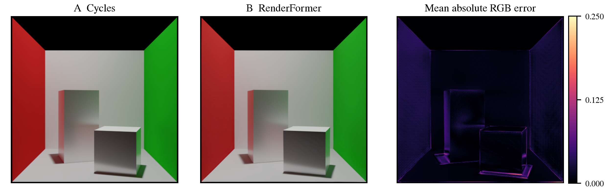
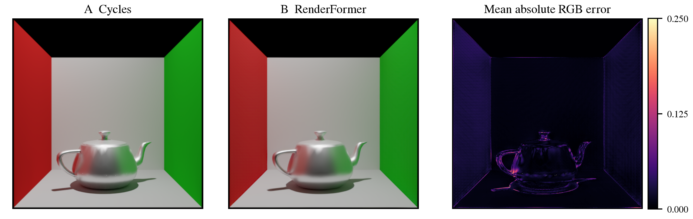
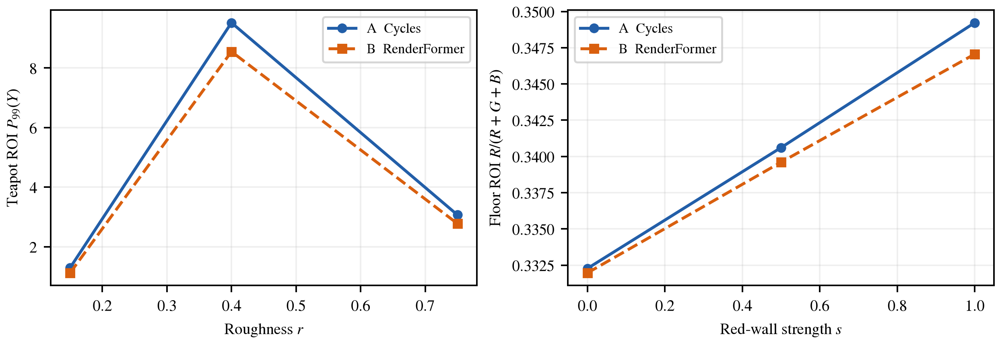
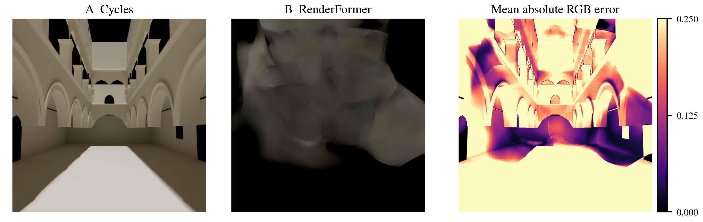

# Transformer 学习方法及其在三角网格神经渲染中的应用
## 以 RenderFormer 为例

## 摘要

渲染把场景中的几何、材质、光源和相机信息转换为图像。传统物理渲染依赖显式计算光的传播，神经渲染则尝试通过数据学习输入场景与输出图像之间的映射。本文选择 Transformer 作为学习方法，以 RenderFormer 为应用实例，说明输入表示、注意力计算、网络结构、监督信号和参数更新如何共同构成学习过程。RenderFormer 将三角网格组织为场景 token，先建立与视角无关的场景表示，再通过射线查询生成目标视角图像。本文完成官方案例、金属茶壶参数实验和 Unity 测试工程中的 Sponza 建筑子集测试，统一输入与参考渲染。官方案例显示域 PSNR 为 33.651 dB，而 Sponza 内部视角仅为 7.780 dB，说明可用性依赖场景条件。低粗糙度实验还揭示显示域相似与 HDR 强高光误差可以同时存在。实验保存版本、线性图像及失败结果，以区分模型误差、转换偏差与显示差异。

关键词：Transformer；监督学习；神经渲染；三角网格；RenderFormer

## 一 学习任务与问题定义

给定三角网格场景 S 和相机 C，渲染器输出图像 I。场景不仅包含物体轮廓，还包含表面法线、材质属性及发光信息。传统路径追踪通过采样光线路径估计像素辐射亮度；RenderFormer 用参数为 θ 的神经网络近似这一映射。模型训练所需的一个监督样本由场景、相机和参考渲染图组成。训练的目标是使网络生成的预测图接近参考图，而不是把某个场景的参考图直接存入模型并在推理时检索。

这一任务的难点在于局部像素依赖全局场景。一个物体的颜色既受自身材质影响，也可能受附近墙壁反射光影响；看不见的光源或遮挡物也可能改变最终图像。若仅对每个三角形独立预测颜色，就难以表示这些关系。Transformer 通过注意力让不同输入元素交换信息，因此可以作为学习场景内部关系的工具。不过，“能交换全局信息”不意味着网络必然学会精确的光传输；最终能力还受数据覆盖、网络容量和优化过程限制。

本文把 RenderFormer 视为学习方法的具体应用，而不是可直接替代 Unity 完整渲染管线的产品。实验首先使用发布的预训练模型进行推理，检验可复现性；随后改变少量可解释参数观察输出。完整重新训练原论文规模的模型并不是本次课程报告完成的前提。论文中的训练过程用于解释方法，本地推理用于检验已学习模型，两者在报告中明确区分。

## 二 Transformer 的表示与注意力计算

Transformer 接收一组向量，即 token。自然语言中 token 可对应词片段，三维场景中则可对应三角形及其属性。设输入矩阵 X 的每一行是一个 token，网络通过可学习的线性映射构造查询、键和值，如式（1）所示。单头注意力见式（2），其中键向量维度用于缩放点积。查询与键的点积描述相关程度，softmax 将其变成每行归一化的权重，再用该权重对值求加权和。

$$Q=XW_Q,\quad K=XW_K,\quad V=XW_V\qquad (1)$$

$$\mathrm{Attention}(Q,K,V)=\mathrm{softmax}\!\left(\frac{QK^{\mathsf{T}}}{\sqrt{d_k}}\right)V\qquad (2)$$

以两个三角形为例，一个接收光照的表面可以通过注意力从另一表面获取与当前预测相关的信息。但注意力权重是网络内部的计算结果，不等于物理上的可见性、反射率或光能传输系数。解释模型时不能仅凭一张注意力图就认定它恢复了真实光路。多头注意力在不同投影空间并行计算关系，再合并结果，使模型能够同时处理多种特征联系。前馈网络对每个 token 进行非线性变换，残差连接和归一化有助于深层网络优化。

自注意力和交叉注意力的区别在于信息来源。自注意力的 Q、K、V 来自同一组表示，适合让场景元素彼此交换信息。交叉注意力的 Q 来自需要回答的查询，K、V 来自另一组条件信息。例如相机射线作为查询，可以从三角形场景表示读取生成该视图所需的信息。仅靠向量集合本身无法知道元素的空间关系，因此还必须引入位置编码。位置编码并非无关紧要的预处理，它决定模型如何区分相同材质在不同空间位置上的三角形。

若采用密集自注意力，N 个 token 的相关性矩阵有 N×N 个元素。这说明三角形数量不仅影响场景细节，也会影响计算量和显存。将模型应用到高复杂度游戏场景时，应先检查模型和转换工具支持的规模，不能把低多边形示例成功直接推广为任意场景均可运行。

例如，一个查询对三个键的缩放后得分为 0、1、2。softmax 先对得分取指数，再除以三项指数之和，得到约 0.090、0.245、0.665 的权重。若对应的值分别为 1、2、4，加权结果约为 3.24。该算例只说明运算，不是模型中真实三角形的测量。若把三个得分同时加上同一个常数，权重不变；若增大得分之间的差距，权重会更集中。这说明网络关注的是相对匹配程度。

点积还与向量维度有关。当维度增大、分量尺度相近时，点积的方差可能增加，使 softmax 更容易饱和。用键维度的平方根缩放，是标准注意力中控制得分尺度的方法。RenderFormer 在此基础上还使用 QK 归一化和空间 RoPE；因此式（2）是理解机制的教学基式，不能替代实际网络的全部实现细节。

位置编码也关系到输入的对称性。三角形数组的第一个或第二个位置只是存储顺序，不应像词序那样决定场景含义。模型应关注三角形的相对空间关系，而不是文件里元素的排序。整体旋转则会改变坐标及方向关系，不能仅凭相对位置编码就认定模型具有旋转不变性。

## 三 RenderFormer 的两阶段网络

原论文中的模型约有 2.05 亿参数。场景三角形 token 的特征维度为 768。三个顶点的法线经过位置编码、线性投影和归一化；材质包含漫反射 RGB、镜面反射 RGB、粗糙度及发光 RGB，共 10 个数值，经过另一分支的投影与归一化后与法线特征相加。必须注意，三角形三个顶点的 9 维坐标并不是简单拼接进这一初始 token；几何位置通过相对空间旋转位置编码参与注意力计算。[1]

第一阶段与视角无关。论文使用 12 层、6 个注意力头的网络，让三角形 token 和 16 个 register token 进行双向自注意力。register token 是额外的可学习表示，用于参与场景信息的组织，而不是场景中额外的几何物体。经过这一阶段，同一个三角形的表示已可以包含其他场景元素的信息；因此它不同于只编码该三角形自身材质的独立描述。对固定场景生成多个视角时，这一阶段的视角无关性为复用场景表示提供了结构基础。[1]

第二阶段依赖相机。网络将每个 8×8 像素块所对应的 64 条射线方向组织为 192 维向量，再投影为 768 维的射线 token。第二阶段包含 6 层：每层先由射线 token 对场景 token 和 register token 做交叉注意力，再让射线 token 之间进行自注意力。前者读取场景条件，后者交换图像区域之间的信息。最后使用后四层特征，经 DPT 解码器重建图像，输出处于 log(x+1) 表示的 HDR 信息。[1]

该设计把“场景是什么”和“从哪里观察”分成两个相互衔接的问题。第一阶段关注全局场景关系，第二阶段以相机查询生成具体图像。两阶段仍然作为一个可训练系统配合学习，不能理解为先精确计算了一份物理光场，再用确定性投影读取它。即使结构能表达全局关系，遇到训练覆盖不足的材质、尺度或复杂几何时仍可能产生失真。

## 四 数据采集与监督学习过程

监督学习需要输入条件与参考输出成对出现。RenderFormer 论文采用合成场景生成训练数据：场景描述提供几何、法线、材质和光源，相机确定观察条件，Cycles 生成参考 HDR 图。原论文的 256×256 阶段包含约 200 万个场景，每场景 4 个视点，共约 800 万张图像；512×512 阶段另使用约 800 万张图像；参考图使用 4096 spp、自适应采样和降噪。合成数据的优势是可以控制场景参数并自动获得对应参考图；局限是采样规则会决定模型见到哪些现象，未覆盖的材质组合或几何结构不一定能可靠泛化。[1]

一次训练迭代首先抽取一批样本，将场景输入两阶段网络得到预测图，然后计算损失，再通过反向传播获得参数梯度，并由优化器更新权重。若学习率为 η，普通梯度下降可由式（3）概括，梯度指向损失增大的方向，因此更新取负梯度方向；论文实际使用 AdamW，其更新还包括梯度统计和权重衰减。训练过程中被改变的是共享网络参数。推理阶段固定这些参数，只输入新场景和相机，不需要该场景的参考图。

$$\theta_{t+1}=\theta_t-\eta\,\nabla_{\theta}\mathcal{L}(\theta_t)\qquad (3)$$

论文损失由 log 域 L1 项和权重为 0.05 的感知损失 LPIPS 组成，LPIPS 在经过色调映射的图像上计算。L1 项约束逐像素数值差异，log 变换压缩 HDR 动态范围，感知项则补充对图像特征差异的约束。不同损失并不等价：两幅图可能有相似的整体外观而局部亮度有偏差，也可能像素误差不大却出现可见的结构模糊。分析结果时应同时检查数值、图像和局部区域，而非只报告单一指标。[1]

原论文使用 8 张 A100 40 GB、batch size 128。先在 256×256 分辨率训练 50 万次迭代，三角形上限为 1536，约 5 天；再在 512×512 分辨率训练 10 万次，三角形上限提高到 4096，约 3 天。这些是论文训练规模，不是本地机器已经完成的训练。当前发布权重修复了训练数据中的 shader 问题并重新训练，因此以发布权重运行得到的结果属于指定版本复现，不能宣称逐项重现原论文的数值。[1][2]

若后续开展教学训练或微调，应按场景或配置族划分训练、验证和测试集。把同一场景的相邻视角随机分到训练和测试集，可能使测试高估泛化能力。训练损失下降也不能单独证明泛化改善；必须在未参与训练的场景配置上检验，同时检查原本表现较好的条件是否退步。

数据生成的每个环节都可能产生系统偏差。若参考 shader 实现有误，模型会学习有误的目标；若数据中某些光照或材质组合很少出现，训练目标对这些情况的约束也较弱。官方对 shader 问题的修复说明，模型版本管理必须同时追踪训练数据语义，不能只记录网络结构名称。

训练、验证与测试承担不同职责。训练集用于计算梯度，验证集用于选择超参数和停止条件，测试集用于在方案确定后评价。若反复查看测试结果再调整实验设置，测试集也会间接参与决策。本项目保留场景配置与图像之间的对应关系，使之后的划分可以按场景来源追踪，而不是仅按图片文件名随机划分。

## 五 复现实验设计与数据流程

实验首先运行官方康奈尔盒示例，以检验场景转换、模型加载和输出保存流程。之后建立独立的康奈尔盒加 Utah 茶壶场景，逐组改变材质粗糙度和侧墙颜色强度。两组实验使用相同的相机、几何和其他参数；对每次修改保存完整配置，使同一条件可以重新生成。粗糙度实验观察高光形态与局部误差，墙面颜色实验分别观察金属壶的反射颜色响应和地面的间接颜色响应。结果可以是吻合，也可以是偏差或失败，均应保留。

统一实验场景描述是两条渲染分支的共同输入。一条分支由 Blender Cycles 生成参考图，另一条分支由 RenderFormer 生成预测图。两边必须使用同一份三角化网格、法线、变换与相机，并核对材质参数含义、发光面几何和强度。不能一边使用高细分物体、一边使用简化网格，再把差异全部解释为神经渲染误差。数据转换本身也是实验的一部分，应记录坐标系、尺度、法线变换和不支持的内容。

Unity 测试限定为允许使用的小型静态场景片段。最小导出插件仅负责导出选中的静态网格、法线、变换以及可转换的材质、相机和灯光，并明确列出不支持项。任意 Shader、透明、粒子、烘焙光照、动画与后处理不属于首版承诺。Unity 截图用于说明原场景外观，主要定量参考使用转换后同场景的 Cycles 图，以降低不同渲染管线造成的混杂因素。

## 六 评价指标与可复现记录

保存原始线性 HDR 图像是后续比较的基础。展示图采用相同曝光、色调映射和颜色处理，防止显示差异被误认为模型差异。参考图也不是天然的绝对真值：应提高采样数，必要时更换随机种子，检查关键区域的变化是否足够小。若参考噪声仍明显，应先解释这一限制，再讨论预测误差。

PSNR 由均方误差 MSE 计算，见式（4）。其中 MAX 的下标 I 表示图像数据约定的取值上限。因此计算前必须说明图像是在色调映射后的 [0,1] 范围、其他归一化范围，还是经过明确变换的 HDR 空间。直接把任意范围的 HDR 数值代入 MAX=1 会使不同实验不可比较。

$$\mathrm{PSNR}=10\log_{10}\!\left(\frac{\mathrm{MAX}_{I}^{2}}{\mathrm{MSE}}\right)\qquad (4)$$

SSIM 补充结构差异信息，也需要记录实现、窗口设置、颜色处理及 data_range。指标不能代替局部分析，尤其是强高光和细小阴影可能只占少量像素。

局部分析先固定区域，再比较参考与预测的平均颜色、亮度或误差。墙面颜色实验可观察固定区域随颜色强度的变化曲线，而不能仅挑两张图主观判断“有颜色渗透”。粗糙度实验可比较高光区域的形态及误差随参数的变化，同时保留整幅图，避免局部区域掩盖其他失真。误差热图统一色标，并明确是线性域绝对误差还是展示域误差。

## 七 实验结果与讨论

本地运行使用 RTX 4060 Laptop GPU、PyTorch 2.8.0+cu128、CUDA 12.8、fp16 autocast 和 SDPA，输出均为 512×512。代码固定为 eec6a9b8d592303def45e458dd4ebd09d6572abc，模型为 microsoft/renderformer-v1-base，权重 revision 为 8aa0009563789dbb6c7785a26aac5da2c9b6d117。上述原论文方法用于理论分析；实际发布 base 权重的输入配置采用 13 通道、32×32 纹理块，展平后为 13312 维，常量属性在纹理块内重复，不能与原论文主方法的 10 维常量材质表示混为一谈。本实验复现的是这一固定发布版本，而非逐项复现原论文训练配置。

参考由 Blender 4.5.1 LTS 的 Cycles 生成，主实验为 4096 spp、seed 1，关闭降噪和自适应采样。两边共享转换后的三角化网格、相机与材质；常量漫反射颜色按官方转换器的 8 位量化规则对齐。官方康奈尔盒有 5633 个三角形，H5 与 Blender 世界顶点最大绝对差为 0，法线最大差为 0.00000331。康奈尔盒及茶壶五档的相机矩阵最大差为 0.000000134，FOV 差为 0.0000000116 rad。输入检查排除了这些已核验项目上的明显转换偏差，但不能代替对所有材质语义的验证。

所有展示与显示域指标统一使用 EV=0、逐通道 Reinhard 和 sRGB 传递函数，负值只在显示变换中截零；线性 HDR 误差保留原始数值。PSNR 和 SSIM 在浮点显示 RGB 上计算，范围设为 1、不裁剪图像；SSIM 使用 7×7 均匀窗口和样本协方差。表 1 的稳态时间为首轮后两次完整双阶段前向的平均，计时前后同步 GPU，未缓存场景表示。加载、H5 读取与传 GPU 另行记录，输出文件保存不计入前向时间。样本次数少，且康奈尔盒前一轮稳态均值为 1.563 s，最终轮为 1.073 s；表中仅列最终轮。笔记本运行波动使这些数值不足以构成严谨性能基准。

表 1 本地真实测量结果。墙色实验固定 r=0.40；s=1.00 与金属壶基线共用。HDR RMSE 为模型相对辐射亮度单位。

<!--results-table-->

官方示例的显示域 PSNR 为 33.651 dB，SSIM 为 0.9764。图 1 中预测保留了两侧墙、物体及大部分阴影布局，误差集中于部分轮廓、接触区域和表面细节。作为参考稳定性检查，4096 spp 与 1024 spp、不同 seed 的两幅 Cycles 图之间 PSNR 为 50.860 dB，SSIM 为 0.9935；这一数值只比较参考采样条件，不能当作模型精度。

金属茶壶使用官方加性 GGX 材质，漫反射 RGB 为 0，镜面 RGB 为 0.9；这是无色金属近似，不是 Unity Metallic 工作流的直接等价映射。粗糙度取 0.15、0.40、0.75，其余条件固定，三角形总数均为 2561。图 2 的基线保持了红绿墙反射与整体轮廓，但壶盖、壶把及局部高光形态仍有偏差。显示域 PSNR 随三个粗糙度档位分别为 31.691、33.974、34.169 dB，这只说明本组场景的误差变化，不证明提高粗糙度在所有场景都能改善模型。

低粗糙度的线性 HDR RMSE 为 1.1802，明显高于基线的 0.1421，尽管显示图整体仍相似。追加 8192 spp、seed 2 参考后，4096 与 8192 参考间显示域 PSNR 为 56.359 dB、SSIM 为 0.9988、HDR RMSE 为 0.0234；同一预测对两份参考的 HDR RMSE 分别为 1.1802 和 1.1899。误差结论没有随参考采样提升而消失。最差约 0.1% 像素贡献约 99.93% 的平方误差，说明少量强高光主导线性域差异。两份参考的全图最大通道值约为 270.62 和 274.19，而预测最大值为 120.875；这些是各图最大值，不表示同一像素的比值。Reinhard 压缩强亮度，因此显示域指标不能替代 HDR 检查。

局部区域在查看预测前固定：茶壶区域为 x∈[180,330)、y∈[330,400)，地面区域为 x∈[100,180)、y∈[460,490)，原点位于图像左上角。图 3 左侧用茶壶区域亮度的第 99 百分位表示上尾响应，亮度按线性 RGB 加权计算。三个粗糙度下，参考值为 1.293、9.521、3.068，预测为 1.120、8.551、2.776。两者均非单调，且预测偏低；该统计量不等于高光面积，也未必覆盖全图最强高光。

侧墙强度取 0、0.5、1，固定粗糙度 0.40。地面区域的红色比例随强度由参考的 0.3323 增至 0.3492，预测由 0.3320 增至 0.3471，趋势一致但高强度下响应偏低。金属壶区域的颜色变化主要体现镜面或粗糙反射对墙色的响应，不能单独作为漫反射颜色渗透的证据；地面区域用于观察间接颜色响应，但没有光路分解 AOV 时，也不能把它断言为某一条纯粹光路的贡献。

Sponza 测试从本地 Unity 测试工程提取建筑骨架，保留相对布局，移除布料、植物和装饰等，并以常量材质近似，最终输入 7328 个三角形。它不等同于原 Unity 场景完整外观。H5 与参考网格顶点最大差为 0，法线差约为 0.000282；独立读取保存的 Blender 相机与 H5 比较，矩阵最大差为 0.000000179，FOV 差为 0.0000000291 rad。图 4 的内部视角预测明显偏暗且结构失真，PSNR 仅 7.780 dB、SSIM 为 0.3203，不能作为成功复现展示。

该场景采用内部近距离相机，设置不同于官方建议的常见外部观察条件，几何数量也高于原论文训练阶段的 4096 上限。训练上限不是推理硬限制，且几何复杂度、视角、材质简化同时变化，不能仅凭此例断定哪一个因素导致失败。由于与训练数据的关系未被完整核实，本报告称其为适用性测试而非严格的分布外评测。进一步保持几何、法线和材质逐元素相同，仅改为距离约 1.903 的外部视角，PSNR 为 13.375 dB、SSIM 为 0.5626，仍有明显失真。由于背景占比与可见区域变化，不能把这两个视角的全图指标差直接解释为质量改善，更不能确立单一因果。保留失败限定了本实验可支持的结论。

## 八 总结

Transformer 将输入组织为 token，以注意力计算元素间的关联，并通过监督损失和反向传播学习参数。RenderFormer 将这一方法用于三角网格渲染，通过视角无关的场景建模和视角相关的射线查询建立场景到图像的映射。理解其数据表示、几何位置编码、损失及训练数据分布，能够解释为什么运行预训练模型只是复现工作的一部分。

本次实验中，官方案例与金属茶壶的整体外观得到较好近似，但强高光的线性域误差仍明显；Sponza 内部视角出现了显著结构失败。数据一致性检查、参考采样复核和多域指标共同帮助解释这些结果。项目未执行重新训练或微调，后续可以在明确数据划分后检验受限场景族的训练收益。本报告不把预训练推理等同于完整训练复现，也不把少量场景成功推广为任意场景泛化。

## 参考文献

[1] Zeng C, Dong Y, Peers P, Wu H, Tong X. RenderFormer: Transformer-based Neural Rendering of Triangle Meshes with Global Illumination. ACM SIGGRAPH 2025 Conference Papers. DOI: 10.1145/3721238.3730595. 论文：https://renderformer.github.io/pdfs/renderformer-paper.pdf 。arXiv：https://arxiv.org/abs/2505.21925 。

[2] Microsoft. RenderFormer 官方代码及版本说明。https://github.com/microsoft/renderformer 。访问日期：2026-10-26。

[3] Vaswani A, et al. Attention Is All You Need. 2017. https://arxiv.org/abs/1706.03762 。

